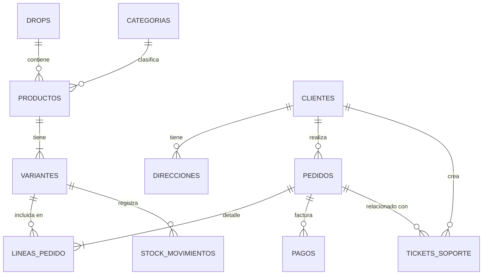

# MILFSHAKES Store - Sistema de Gestión de Base de Datos (PostgreSQL)
***Autores: Jorge Fuentes Aguilar y Carlos Medina Augusto**

Este proyecto consiste en el diseño, implementación y explotación de una base de datos relacional para ""M***SHAKES"", una tienda online de moda y accesorios exclusivos inspirada en la marca de Nil Ojeda. El modelo de negocio se basa en lanzamientos de colecciones limitadas ("drops") de alta expectación.

La base de datos está diseñada sobre **PostgreSQL 15.3** y gestionada mediante **pgAdmin 4**, orquestados a través de **Docker Compose** para garantizar portabilidad y un entorno aislado y limpio.

---


## 🛠️ Paso 1: Configuración de la Infraestructura (Docker)

Para ejecutar la base de datos sin necesidad de instalar dependencias locales en el sistema operativo, se utilizó **Docker Compose** con el archivo [docker-compose.yml](file:///C:/Users/jorge/Desktop/Proyecto%20BBDD/docker-compose.yml).

### Configuración del Entorno:
* **Base de Datos (Servicio `myDB`)**:
  * **Motor**: `postgres:15.3`
  * **Puerto Host**: `5436` (mapeado al puerto interno `5432`)
  * **Base de Datos**: `course_db`
  * **Usuario / Password**: `alumno` / `123456`
  * **Volumen persistente**: `./postgres` en la máquina local montado en `/var/lib/postgresql/data`.
* **Administración (Servicio `pdAdmin` / pgAdmin4)**:
  * **Puerto Host**: `8080` (mapeado al puerto interno `80`)
  * **Credenciales de Acceso**: `alumno@google.com` / `123456`
  * **Volumen persistente**: Carpeta `./pgadmin` para configuraciones, certificados y credenciales guardadas.

### Comandos de Ejecución:
Para levantar los servicios por primera vez o reanudarlos, se ejecuta el siguiente comando en la raíz del proyecto:
```bash
docker-compose up -d
```
Este comando arranca ambos contenedores en segundo plano (`-d`). La base de datos queda accesible en `localhost:5436` y la interfaz web de administración en `http://localhost:8080`.

---

## 📊 Paso 2: Diseño del Modelo Entidad-Relación

El diseño de la base de datos consta de **11 tablas** distribuidas en 3 capas de lógica de negocio (Catálogo, Clientes & Logística y Operaciones & Soporte).

### Diagrama Entidad-Relación (ER)



---

## 🗄️ Paso 3: Estructura de Tablas y Restricciones (DDL)

El archivo **[creacionTablas.sql](file:///C:/Users/jorge/Desktop/Proyecto%20BBDD/creacionTablas.sql)** contiene las sentencias de definición de datos. A continuación se explican las tablas agrupadas por su rol:

### 1. Capa de Catálogo (Ropa y Colecciones)
* **`drops`**: Gestiona los lanzamientos exclusivos.
  * `estado` tiene una restricción de validación `CHECK` para que solo admita `'proximamente'`, `'activo'` o `'finalizado'`.
* **`categorias`**: Familias de prendas (ej: Sudaderas, Camisetas). El nombre es `UNIQUE` para evitar duplicaciones.
* **`productos`**: Catálogo general de modelos de ropa (ej: "Sudadera Classic Cream"). Vinculado a una categoría y a un drop específico.
* **`variantes`**: Concreción física del producto por Talla y Color (ej: Talla M, Color Crema).
  * Incluye el `sku` (código de almacén único) y restricciones de validación: `precio_actual > 0` y `stock >= 0`.
  * Define la regla `ON DELETE CASCADE` en la clave foránea a productos: si se elimina un producto padre, se borran automáticamente todas sus variantes físicas del almacén.

### 2. Capa de Clientes y Logística (Ventas)
* **`clientes`**: Información de usuarios registrados (nombre, email único y contraseña protegida).
* **`direcciones`**: Direcciones de envío de los clientes. Admite múltiples direcciones por cliente, identificando una como predeterminada mediante un booleano (`es_predeterminada`).
* **`pedidos`**: Cabecera de compra.
  * **Integridad de Datos**: Cuenta con la columna `direccion_envio_fijada TEXT`. Al realizar la compra, se copia textualmente la dirección de envío actual en este campo. Si en el futuro el cliente edita o borra sus direcciones registradas, el histórico fiscal y contable del pedido permanece intacto y fiel a dónde se mandó originalmente.
* **`lineas_pedido`**: Detalles individuales de cada artículo comprado.
  * **Integridad de Precios**: Guarda `precio_unitario_venta` de forma estática en el momento de la venta. Si la variante cambia de precio en el futuro en la tabla `variantes`, el total del pedido histórico no se ve alterado.

### 3. Capa de Operaciones y Soporte
* **`pagos`**: Pasarela de pago de los pedidos (Bizum, Tarjeta, Paypal).
* **`stock_movimientos`**: Registro/Auditoría física de entradas y salidas de stock. Su campo `tipo_movimiento` cuenta con un `CHECK` que solo acepta `'entrada'`, `'venta'`, `'devolucion'` o `'ajuste'` (pérdidas, mermas o taras).
* **`tickets_soporte`**: Incidencias abiertas por clientes, opcionalmente vinculadas a un pedido.
  * Si el pedido vinculado se elimina de la base de datos, el ticket no se borra; en su lugar, el campo `id_pedido` cambia a `NULL` mediante `ON DELETE SET NULL` para mantener el historial de quejas.

---

## 📥 Paso 4: Poblado e Ingesta de Datos (DML)

Para cargar los datos de prueba sin duplicar registros al ejecutar el script varias veces, se implementó una estrategia en **[inserciones/insercionDeDatos.sql](file:///C:/Users/jorge/Desktop/Proyecto%20BBDD/inserciones/insercionDeDatos.sql)**:

1. **Truncado en Cascada con Reinicio de Secuencias**:
   ```sql
   TRUNCATE TABLE 
       lineas_pedido, pedidos, pagos, tickets_soporte, 
       stock_movimientos, variantes, productos, categorias, 
       drops, clientes, direcciones 
   RESTART IDENTITY CASCADE;
   ```
   * `RESTART IDENTITY` asegura que los contadores autoincrementales de claves primarias (`SERIAL` / `GENERATED ALWAYS AS IDENTITY`) vuelvan a empezar en 1.
   * `CASCADE` permite borrar los registros a pesar de las restricciones de clave ajena activas.

2. **Carga de Entidades**:
   * Se crearon lanzamientos ficticios como *Milfshakes OG Collection* y *Summer Drop 26*.
   * Se insertaron 4 categorías y 9 productos con múltiples variantes físicas de tallas (S, M, L, XL, Única) e inventarios controlados.
   * Se registraron clientes simulados emblemáticos del panorama digital actual (Nil Ojeda, Ibai Llanos, TheGrefg, Gerard Piqué y Misho Amoli) con direcciones asignadas en Madrid, Barcelona y Andorra.
   * Se procesaron transacciones de prueba con pagos asociados, movimientos de inventario específicos (entradas de fábrica y ajustes por prendas rotas) y tickets de soporte para auditoría.

---

## 🔍 Paso 5: Consultas Operativas y Reportes de Negocio (DQL)

El núcleo analítico del proyecto reside en **[consultas/consultas.sql](file:///C:/Users/jorge/Desktop/Proyecto%20BBDD/consultas/consultas.sql)**. Las consultas están divididas en dos grandes bloques:

### Bloque A: Operativa Básica y Reportes Diarios

1. **Catálogo Completo**: Cruce con `JOIN` para asociar productos, categorías y drops correspondientes.
2. **Alerta de Stock Bajo**: Consulta filtrada con `WHERE stock < 5` para que los operarios de almacén identifiquen qué prendas necesitan reposición inmediata.
3. **Ranking de Productos Más Vendidos**: Agregación con `SUM(cantidad)` combinada con `GROUP BY` y ordenación descendente para evaluar la popularidad de los diseños.
4. **Recaudación por Drop**: Multiplicación directa en agregación `SUM(cantidad * precio_unitario_venta)` agrupando por colección para analizar la rentabilidad de cada campaña.
5. **Ticket Medio**: Uso de `AVG(total)` sobre las ventas globales.
6. **Clientes VIP con Gasto Acumulado**: Filtrado avanzado usando la cláusula `HAVING` (necesaria al aplicar filtros sobre funciones de agregación como `SUM(pedidos.total)`) para listar usuarios con compras superiores a 50€.

### Bloque B: Consultas Complejas e Informes de Gestión

* **Pedidos Recientes por Ubicación (Últimos 3 Meses)**:
  * Filtro temporal dinámico mediante `fecha >= NOW() - INTERVAL '3 months'`.
  * Filtro de texto parcial usando `calle LIKE '%España%'`.
* **Informe de Mermas y Unidades Perdidas**:
  * Utiliza la función de valor absoluto `ABS(cantidad)` para transformar ajustes negativos de stock (ej. pérdidas de -1 unidad) en valores positivos listos para sumar y reportar.
* **Auditoría de Pasarela**:
  * Cronología ordenada mediante `ORDER BY fecha ASC` para verificar reintentos de pago sobre el mismo carro.
* **Ranking Top 10 con Funciones de Ventana (`Window Functions`)**:
  ```sql
  SELECT pr.nombre, SUM(lp.cantidad) AS unidades_vendidas,
         RANK() OVER (ORDER BY SUM(lp.cantidad) DESC) AS ranking
  FROM lineas_pedido lp
  ...
  WHERE p.estado != 'cancelado'
  GROUP BY pr.nombre;
  ```
  * `RANK() OVER` calcula una clasificación numérica al vuelo basada en el rendimiento de ventas sin colapsar el agrupamiento.
* **Análisis Financiero Temporal con CTEs (`Common Table Expressions`)**:
  * Creación de una tabla virtual temporal (`WITH gastos AS (...)`) que realiza cálculos condicionales (`CASE WHEN`) para separar el gasto acumulado histórico del gasto realizado específicamente durante el mes en curso.
* **Algoritmo de Recomendación Cruzada (`Cross-Selling` con `Self-Join`)**:
  * Cruza la tabla `lineas_pedido` consigo misma (`JOIN lineas_pedido lp2 ON lp2.id_pedido = lp1.id_pedido AND lp2.id > lp1.id`).
  * Identifica qué productos se compran juntos con mayor frecuencia.
  * La condición `lp2.id > lp1.id` evita duplicados simétricos (ej. reportar por separado "Camiseta + Gorra" y "Gorra + Camiseta") y que se compare un artículo consigo mismo.

---

## 💾 Paso 6: Respaldo y Recuperación (Backup)

Para garantizar la durabilidad del proyecto, se generó un volcado completo de la base de datos en **[backup_proyectobbdd_tiendaonline.sql](file:///C:/Users/jorge/Desktop/Proyecto%20BBDD/backup_proyectobbdd_tiendaonline.sql)**.

Este archivo contiene el script completo necesario para reconstruir toda la base de datos (estructura de tablas, restricciones de clave ajena y datos cargados) en cualquier otro servidor PostgreSQL.

Para restaurar este backup en un contenedor limpio, se puede ejecutar el comando:
```bash
docker exec -i tienda_online_db psql -U alumno -d course_db < backup_proyectobbdd_tiendaonline.sql
```
