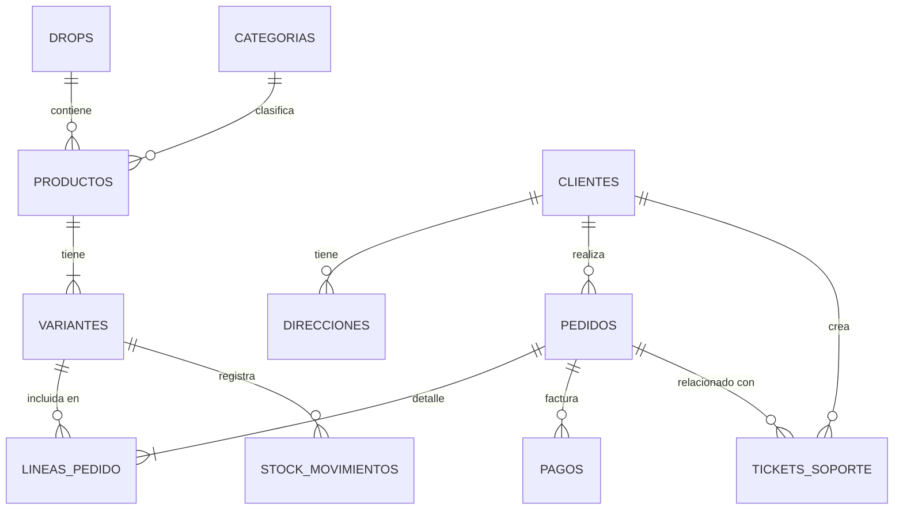

# 🥤 MILFSHAKES Store - Sistema de Gestión de Base de Datos (PostgreSQL)

[](https://www.postgresql.org/)
[](https://www.docker.com/)
[](https://www.pgadmin.org/)
[](#)

Diseño, implementación y explotación de una base de datos relacional para **MILFSHAKES Store**, tienda online de moda y accesorios exclusivos inspirada en la marca de Nil Ojeda. El modelo de negocio se basa en lanzamientos de colecciones limitadas (*drops*) de alta expectación.

Desarrollada sobre **PostgreSQL 15.3** y administrada mediante **pgAdmin 4**, orquestados a través de **Docker Compose** para garantizar portabilidad, persistencia e infraestructura aislada.

---

## 👥 Autores y Contexto Académico

* **Autores:** Jorge Fuentes Aguilar ([@jorgefuentess9](https://github.com/jorgefuentess9)) y Carlos Medina Augusto
* **Estudios:** 1º de Desarrollo de Aplicaciones Multiplataforma (DAM)
* **Asignatura:** Bases de Datos (BBDD)
* **Tecnologías:** PostgreSQL 15.3, Docker, Docker Compose, pgAdmin 4, SQL

---

## 🛠️ Paso 1: Configuración de la Infraestructura (Docker)

El entorno se levanta íntegramente mediante **Docker Compose** (`Proyecto BBDD/docker-compose.yml`), evitando dependencias locales en el sistema operativo:

### Configuración del Entorno:
* **Base de Datos (Servicio `myDB`)**:
  * **Motor**: `postgres:15.3`
  * **Puerto Host**: `5436` (mapeado al puerto interno `5432`)
  * **Base de Datos**: `course_db`
  * **Usuario / Password**: `alumno` / `123456`
  * **Volumen persistente**: `./postgres` montado en `/var/lib/postgresql/data`.
* **Administración (Servicio `pdAdmin` / pgAdmin 4)**:
  * **Puerto Host**: `8080` (mapeado al puerto interno `80`)
  * **Credenciales de Acceso**: `alumno@google.com` / `123456`
  * **Volumen persistente**: `./pgadmin` para configuraciones y credenciales guardadas.

### Comandos de Ejecución:
Para arrancar los servicios en segundo plano:

```bash
docker-compose -f "Proyecto BBDD/docker-compose.yml" up -d
```

- **Base de datos accesible en:** `localhost:5436`
- **Panel pgAdmin 4 en el navegador:** `http://localhost:8080`

---

## 📊 Paso 2: Modelo Entidad-Relación (ER)

El diseño consta de **11 tablas relacionales** organizadas en 3 capas de lógica de negocio:



---

## 🗄️ Paso 3: Estructura de Tablas y Restricciones (DDL)

El archivo [`creacionTablas.sql`](Proyecto%20BBDD/creacionTablas.sql) define la estructura y las reglas de integridad referencial:

### 1. Capa de Catálogo (Ropa y Colecciones)
* **`drops`**: Lanzamientos exclusivos. Su columna `estado` valida mediante restricción `CHECK` que solo admita `'proximamente'`, `'activo'` o `'finalizado'`.
* **`categorias`**: Familias de prendas (ej: Sudaderas, Camisetas). El nombre es `UNIQUE`.
* **`productos`**: Catálogo general de modelos de ropa, asociado a un drop y una categoría.
* **`variantes`**: Concreción física por talla y color con código de almacén `sku` único. Restricciones: `precio_actual > 0` y `stock >= 0`. Clave foránea con `ON DELETE CASCADE` para eliminar variantes automáticamente si se borra el producto padre.

### 2. Capa de Clientes y Logística (Ventas)
* **`clientes`**: Información de usuarios (nombre, email `UNIQUE`, contraseña protegida).
* **`direcciones`**: Direcciones de envío con soporte para múltiples entradas y selección de predeterminada (`es_predeterminada`).
* **`pedidos`**: Cabecera de compra. Dispone del campo `direccion_envio_fijada TEXT` para guardar una copia congelada de la dirección al momento de comprar, garantizando fidelidad fiscal e histórica si el cliente modifica o elimina su dirección posteriormente.
* **`lineas_pedido`**: Detalles de cada artículo comprado. Almacena `precio_unitario_venta` de forma estática en el instante de la venta para preservar el histórico ante futuros cambios de precio en `variantes`.

### 3. Capa de Operaciones y Soporte
* **`pagos`**: Pasarela de pago de los pedidos (Bizum, Tarjeta, PayPal).
* **`stock_movimientos`**: Auditoría de inventario con `CHECK` para admitir solo `'entrada'`, `'venta'`, `'devolucion'` o `'ajuste'`.
* **`tickets_soporte`**: Incidencias vinculadas opcionalmente a un pedido. Si el pedido se elimina, el campo cambia a `NULL` (`ON DELETE SET NULL`) para preservar el historial de reclamaciones.

---

## 📥 Paso 4: Poblado e Ingesta de Datos (DML)

Los scripts [`insercionDeDatos.sql`](Proyecto%20BBDD/insercionDeDatos.sql) e [`insercionDatos1.sql`](Proyecto%20BBDD/insercionDatos1.sql) gestionan la carga de datos:

1. **Truncado seguro e idempotente:**
   ```sql
   TRUNCATE TABLE 
       lineas_pedido, pedidos, pagos, tickets_soporte, 
       stock_movimientos, variantes, productos, categorias, 
       drops, clientes, direcciones 
   RESTART IDENTITY CASCADE;
   ```
   * `RESTART IDENTITY` reinicia los contadores autoincrementales (`SERIAL` / `IDENTITY`) a 1.
   * `CASCADE` permite vaciar las tablas respetando la jerarquía de claves foráneas.

2. **Datos Simulados:**
   * Colecciones temáticas (*Milfshakes OG Collection*, *Summer Drop 26*).
   * 4 categorías, 9 productos y múltiples variantes de tallas (S, M, L, XL, Única).
   * Clientes ficticios del entorno digital (Nil Ojeda, Ibai Llanos, TheGrefg, Gerard Piqué, Misho Amoli) con direcciones en Madrid, Barcelona y Andorra.
   * Transacciones de compra, pagos, registros de auditoría de inventario y tickets de soporte.

---

## 🔍 Paso 5: Consultas y Reportes de Negocio (DQL)

El script [`consultas.sql`](Proyecto%20BBDD/consultas.sql) contiene análisis y consultas organizadas en dos bloques:

### Operativa Básica y Reportes Diarios:
1. **Catálogo Completo:** `JOIN` entre productos, categorías y colecciones.
2. **Alerta de Stock Bajo:** Filtro `WHERE stock < 5` para reposición inmediata.
3. **Ranking de Más Vendidos:** `SUM(cantidad)` con `GROUP BY` y orden descendente.
4. **Recaudación por Drop:** Cálculo de ingresos agregados por colección (`SUM(cantidad * precio_unitario_venta)`).
5. **Ticket Medio:** Cálculo mediante función de agregación `AVG(total)`.
6. **Clientes VIP:** Cláusula `HAVING SUM(pedidos.total) > 50` para clientes de alto valor.

### Consultas Avanzadas e Informes de Gestión:
* **Filtros Temporales y Parciales:** Ventas de los últimos 3 meses (`fecha >= NOW() - INTERVAL '3 months'`) y direcciones coincidentes (`LIKE '%España%'`).
* **Auditoría de Mermas:** Uso de valor absoluto `ABS(cantidad)` para sumarizar pérdidas y prendas dañadas.
* **Funciones de Ventana (`Window Functions`):**
  ```sql
  SELECT pr.nombre, SUM(lp.cantidad) AS unidades_vendidas,
         RANK() OVER (ORDER BY SUM(lp.cantidad) DESC) AS ranking
  FROM lineas_pedido lp
  ...
  GROUP BY pr.nombre;
  ```
* **CTEs (`Common Table Expressions`):** Tablas temporales virtuales para segmentar gasto mensual frente al acumulado histórico.
* **Algoritmo de Venta Cruzada (`Cross-Selling` con `Self-Join`):**
  * Cruza `lineas_pedido` consigo misma para detectar artículos comprados conjuntamente de forma recurrente, evitando duplicados simétricos (`lp2.id > lp1.id`).

---

## 💾 Paso 6: Respaldo y Restauración (Backup)

El repositorio incluye un volcado SQL completo en [`backup_proyectobbdd_tiendaonline.sql`](Proyecto%20BBDD/backup_proyectobbdd_tiendaonline.sql).

Para restaurar el respaldo en un contenedor Docker limpio:

```bash
docker exec -i tienda_online_db psql -U alumno -d course_db < "Proyecto BBDD/backup_proyectobbdd_tiendaonline.sql"
```

---

## 📁 Estructura del Repositorio

```text
m-shakes/
├── .gitignore                                     # Exclusiones de Git (datos de postgres, pgadmin, temporales)
├── README.md                                      # Documentación principal del repositorio
└── Proyecto BBDD/
    ├── docker-compose.yml                         # Orquestación de PostgreSQL 15.3 y pgAdmin 4
    ├── creacionTablas.sql                         # Definición de tablas, constraints y relaciones (DDL)
    ├── insercionDeDatos.sql                       # Script principal de inserción y reinicio (DML)
    ├── insercionDatos1.sql                        # Inserciones complementarias
    ├── consultas.sql                              # Consultas analíticas y reportes de negocio (DQL)
    ├── selectTablas.sql                           # Comprobaciones rápidas de datos
    ├── ejerciciosTablas.sql                       # Ejercicios y pruebas sobre tablas
    ├── backup_proyectobbdd_tiendaonline.sql       # Respaldo completo de la base de datos
    └── documentacionProyecto.md                   # Documentación técnica extendida
```
